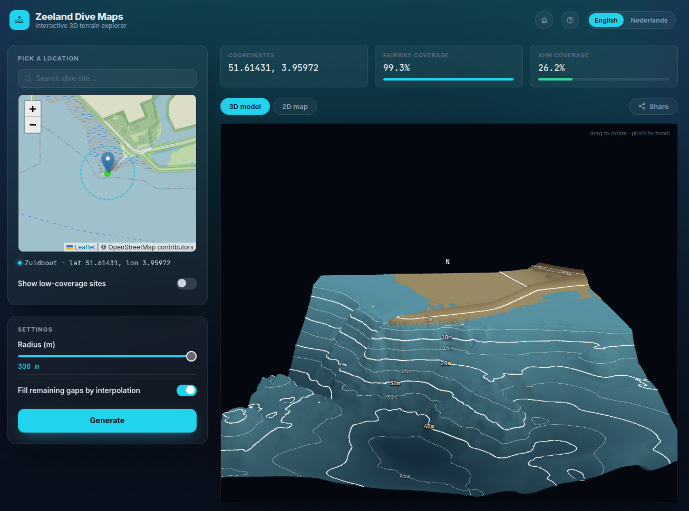
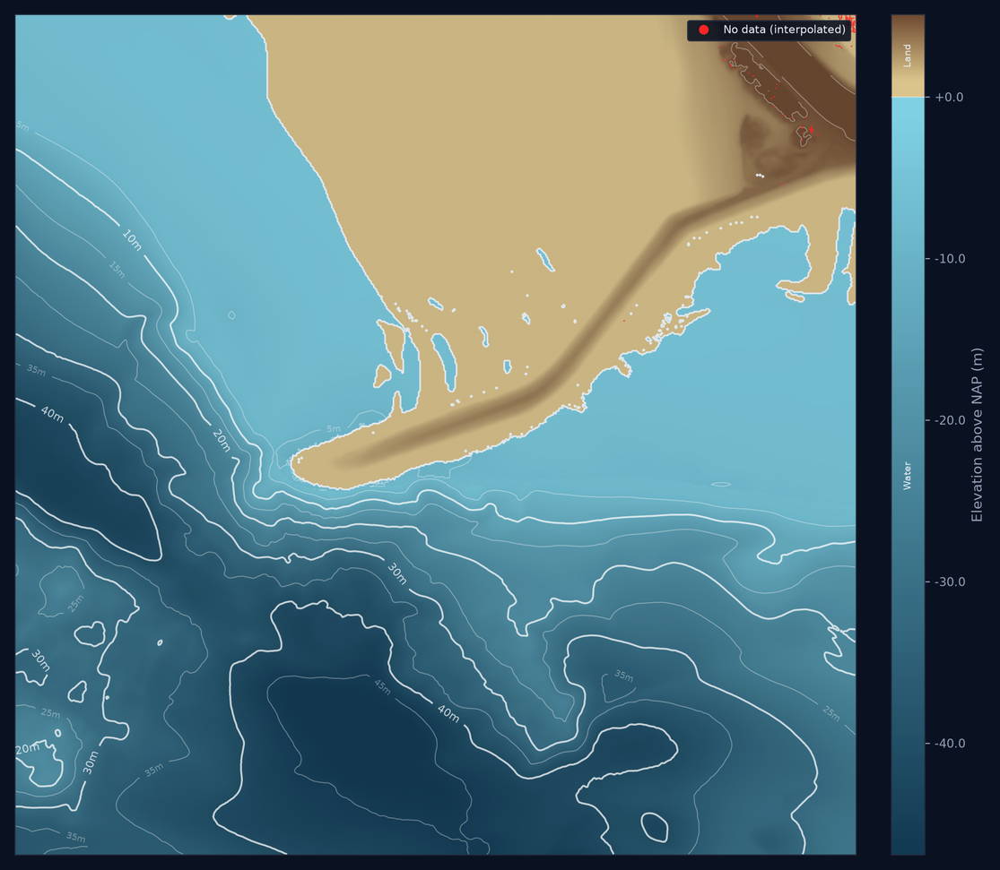

# Bathymetry Explorer

Terrain explorer for dive sites in Zeeland.

Pick a spot on the map (or one of ~125 dive sites from
[duikersgids.nl](https://www.duikersgids.nl/duiklocaties-in-nederland/zeeland)).
The app streams elevation data from Dutch government sources, merges it and
shows an interactive 3D model & a 2D elevation map.

<p>
  
  
</p>

Heights and depths are in **m NAP** (roughly mean sea level). The interface
is in English and Dutch.

## Quick start

Docker:

```sh
docker compose up -d --build
```

Then open http://localhost:8000.

Without Docker (Python 3.12):

```sh
pip install -r requirements.txt
uvicorn bathymetry.app:app --reload
```

## Project layout

```
bathymetry/              Python package
  app.py                 FastAPI app: page, /api/* endpoints
  config.py              paths, bounds and defaults
  i18n.py                English/Dutch UI strings
  dive_sites.py          load/save the dive site list
  site_cache.py          on-disk terrain cache for dive sites
  terrain/
    sources.py           remote AHN and vaargeul tile locations
    grid.py              fetch, merge, crop and gap-fill the elevation grid
    colors.py            shared terrain colours
    errors.py            PipelineError (user-facing failures)
    render2d.py          2D PNG map
    scene3d.py           downsampled mesh for the 3D viewer
    pipeline.py          render_terrain / generate_terrain entry points
data/
  dive_sites_zeeland.json  Zeeland dive sites from duikersgids, with coverage
  kaartbladindex_dtm.json  AHN DTM tile index (PDOK)
static/
  app.html               page shell (meta tags, script and style links)
  app.css                styles
  app.js                 React UI: map, settings, progress, results
  scene3d.js             Three.js 3D terrain viewer
  og-image.png           social media preview image
docs/                    README screenshots
scripts/                 maintenance scripts (see below)
```

The front end has no build step: React, Leaflet, Three.js and htm are loaded
from unpkg, and `app.js` / `scene3d.js` are plain ES modules.

## API

| Endpoint | Purpose |
| --- | --- |
| `GET /` | the app |
| `GET /api/config` | map bounds, dive sites, languages |
| `GET /api/strings?lang=en` | UI strings for one language |
| `POST /api/generate` | build the terrain for `{lat, lon, radius, fill_gaps}`; streams progress and then the result as NDJSON |

## Data sources

Every source is read over HTTP with GDAL `/vsicurl/` range requests, only the area around the site is fetched.

- **AHN** (land): national airborne LiDAR elevation, 0.5 m, served by PDOK as one GeoTIFF per map sheet. DTM (Terrain, "maaiveld") model is used which shows bare ground without
structures/trees etc.
- **vaargeul** (water): Rijkswaterstaat depth soundings. 1 m regional tiles are used first, gaps are filled with a 10 m province-wide composite.

### Merging

Per pixel, AHN wins where it has data. vaargeul fills the remaining pixels, but only where it is below NAP, a coarse sounding can't override data at the
coastline. Pixels neither source covers are gaps and may be filled through (Jacobi) interpolation.

Land and water colours are determined based on the origin of a cell value, terrain < NAP is not necessarily filled with water (as the area behind dikes is
often under NAP.)

## Caching

Known dive sites are cached in `site_cache/` as the merged grid 300m with filled gaps. The cache fills itself as sites are visited. It can also be precomputed
for all sites (`python scripts/precompute_site_terrain.py`).


## Scripts

| Script | Purpose |
| --- | --- |
| `precompute_site_terrain.py` | fill the terrain cache for every dive site |
| `precompute_site_coverage.py` | store each site's data coverage (low-coverage sites are hidden by default) |
| `list_ahn_tiles.py` | list or download the AHN tiles covering Zeeland |

## Credits

- Elevation: [AHN](https://www.ahn.nl/) via [PDOK](https://www.pdok.nl/),
  and [Rijkswaterstaat](https://downloads.rijkswaterstaatdata.nl/)
- Dive sites: [Duikersgids](https://www.duikersgids.nl/)
